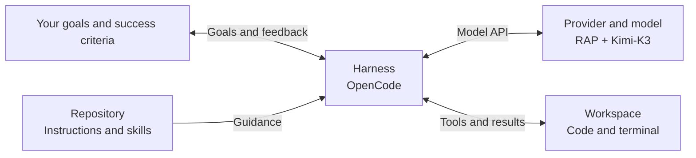
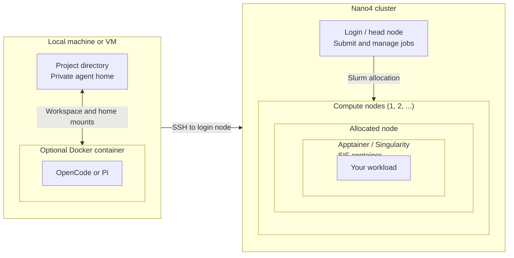
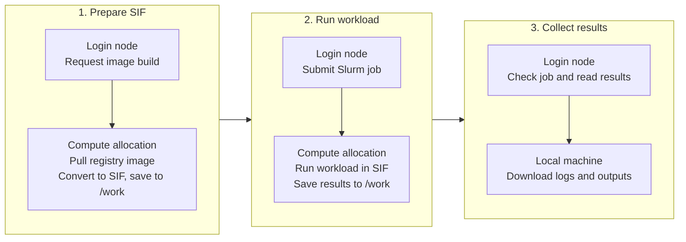

# Agentic Samples

[](https://app.slack.com/client/T0C70DGFW02)
[](https://nchcopenhackathon2026.slack.com/archives/C0C749A0NTE)

Examples for the [NCHC Open Hackathon](https://www.openhackathons.org/s/siteevent/a0CUP00004AB2oc2AD/se000481).
This year, we focus on using coding agents to help optimize your workload.
Your role is to set the goal, provide domain knowledge, and judge the evidence.
The agent can inspect code, make changes, run experiments, and collect results.

Think of agents as a team of capable interns, available around the clock.
Give them a clear assignment, a suitable workspace, and a way to check their
work. For optimization, that means a baseline, a correctness test, and a
performance target. Your team's NVIDIA mentor can help with domain questions.

This guide follows four stages, each with a short demonstration:

1. [Understand the agent and model provider](#1-understand-the-agent-and-model-provider).
2. [Give the agent a suitable environment](#2-give-the-agent-a-suitable-environment).
3. [Check single-node GPU access on Nano4](#3-check-single-node-gpu-access-on-nano4).
4. [Run multi-node workloads on Nano4](#4-run-multi-node-workloads-on-nano4).

Follow this README for the complete workflow. If your Nano4 account is not set
up, also read [NCHC iService setup](docs/nchc-iservice.md). Other Markdown files
are optional supplementary material. Your agent can consult them as needed.

The guide will be updated during the event. If you encounter issues or want to
suggest improvements, feel free to tag `@Johnson Sun` in
[#cluster-support](https://nchcopenhackathon2026.slack.com/archives/C0C749A0NTE).

## 1. Understand the agent and model provider

In a chat-only exchange, a model can suggest an optimization from the text you
provide. Without access to your code and an execution environment, it cannot
run your workload or verify a speedup. A coding **harness** supplies tools for
reading files, editing code, and running terminal commands. The model uses the
results to choose its next step, forming a
[feedback loop](https://www.anthropic.com/engineering/building-effective-agents).



Choose these three pieces deliberately:

| Piece | What it controls | Our default |
|---|---|---|
| Provider and model | Reasoning, model capabilities, and how sent data is handled | RAP + Kimi-K3 |
| Harness | Tools, sessions, and permissions | OpenCode |
| Execution environment | Accessible files, credentials, and compute resources | A workspace you can give the agent control over |

[Codex](https://openai.com/codex/) and [Claude Code](https://code.claude.com/docs/en/overview)
are alternatives if you already have a subscription.
[Pi](https://pi.dev/) is our secondary option for a smaller, customizable harness.
Prompts describe the goal and constraints. Repository instructions and skills
provide reusable procedures, such as how to submit a Nano4 job.

The provider receives the prompts and file contents sent by the harness.
Some [OpenCode free models](https://docs.opencode.ai/docs/zen/#privacy) may use
this data to improve models, so use them for public setup examples.
For event work, we use RAP. Its
[data-protection guidance](https://rap-docs.genai.nchc.org.tw/docs/service_intro/home/#%E7%94%A8%E6%88%B6%E8%B3%87%E6%96%99%E4%BF%9D%E8%AD%B7)
says retained operational records are not used for model training and are
deleted after six months.

### Demo: start OpenCode and connect RAP

On a host you are comfortable giving the agent access to, use Ubuntu, macOS,
or Windows with WSL2. The examples need Bash, Git, OpenSSH, and rsync 3+.
If your personal machine is unsuitable, use a dedicated VM or start with the
[Docker demo below](#demo-run-the-same-agent-inside-docker), then return to
[Connect RAP in OpenCode](#connect-rap-in-opencode).

**On Ubuntu or Ubuntu in WSL2**, install the tools in your terminal first.
In a root container, omit `sudo`:

```bash
sudo apt-get update
sudo apt-get install -y --no-install-recommends \
  ca-certificates curl unzip git openssh-client rsync
```

**On Ubuntu, macOS, or WSL2**, install OpenCode with its
[official installer](https://opencode.ai/docs/#install).
If already installed, use `opencode upgrade` and skip the installer:

```bash
curl -fsSL https://opencode.ai/install -o /tmp/opencode-install.sh && bash /tmp/opencode-install.sh
export PATH="$HOME/.opencode/bin:$PATH"
opencode --version
```

The `export` makes OpenCode available in this terminal. Follow the installer's
shell-profile instructions to keep it available in later terminals.
On Windows, use the same Ubuntu WSL2
environment for all commands.

Start in an empty working directory. `--auto` lets the agent work without
repeated approval prompts:

```bash
mkdir -p ~/nchc-hackathon
cd ~/nchc-hackathon
opencode --auto
```

Use an available free model, selecting one with `/models` if needed. Ask:

> Clone https://github.com/j3soon/agentic-samples.git into `.`. Check Git, OpenSSH, and rsync 3+, installing missing tools.

Enter any administrator password only in your own terminal.

After cloning, exit OpenCode with `/exit` and relaunch `opencode --auto` from
the same directory so it starts with the repository's instructions and skills.
If you already have a clone, start the agent there and skip the clone prompt.

#### Connect RAP in OpenCode

Follow this handoff in your chosen host, VM, or Docker session.
Your mentor shares your team's pre-created RAP API key in your team Slack
channel. Ask:

> Set up OpenCode with RAP + Kimi-K3 and test image reading.

The agent can configure the provider before you have entered its key, but the
image test needs authentication. When it asks for the key, enter it locally
with `/connect` → **Other** → provider ID `nchc-rap` → your RAP API key.
You may also give this rotatable key to the agent. See
[credential entry](docs/nchc-iservice.md#enter-the-key-locally).

Exit with `/exit` and restart in the same environment to refresh provider settings:

- **Host or VM:** run `opencode --auto` again from the repository.
- **Docker:** run `docker exec -it opencode opencode --auto` in your host
  terminal. `/exit` leaves the container and its SSH connection running.
  No container restart or rebuild is needed.

Select `nchc-rap/Kimi-K3` with `/models`. In the RAP session, ask:

> RAP is connected. Test image reading.

Continue with **RAP + Kimi-K3** for event work.
Each team starts with a **NT$20,000 RAP budget**. If you exceed it or need more,
contact your mentor. Additional budget can be requested up to **NT$40,000**.
Service rate limits still apply.

**Look for:** the repository in your working directory, RAP selected as the
provider, and a passing image-reading check. The agent should show what it
tested, rather than just say setup is complete.

## 2. Give the agent a suitable environment

You would give an intern access to the files needed for their assignment.
Apply the same judgment to an agent. On a personal machine, full permissions
can expose unrelated files and credentials. Requiring approval for every
command also slows a sequence of edits, tests, and experiments.

Choose a workspace where the agent can work independently. Running directly
on your computer is an option if you accept its access. A dedicated VM or a
Docker container lets you keep unrelated personal files outside the workspace.
Use the commands below for Docker, or the first demo's commands on your host
or dedicated VM.



There are two different container roles. **Docker runs the agent locally** with
its tools and settings. **Apptainer/Singularity runs your workload on Nano4**
from a SIF image containing its dependencies. You can build that image from a
Docker registry image on allocated cluster resources, without installing the
workload's packages on the login node. Docker is optional for the local agent.
Run Nano4 workloads inside the Apptainer/Singularity container.

The agent can still change files in mounted directories. Mount only its project
and a separate private home. Container isolation controls local access, while
the selected provider's policy controls data sent to the model.

### Demo: run the same agent inside Docker

This demo is optional. If you already run the agent in a suitable container or
dedicated VM, keep that session and continue to [Nano4](#3-check-single-node-gpu-access-on-nano4).
Run Docker build and launch commands on the machine with Docker installed.
Install [Docker Engine or Docker Desktop](https://docs.docker.com/get-started/get-docker/)
on your machine first. You do not need Docker inside the agent container.

If you already have an agent and a clone, ask:

> Build the OpenCode Docker image and show me the README launch command.

If you are starting with Docker and have no clone or agent yet, run this in
your host terminal instead:

```bash
git clone https://github.com/j3soon/agentic-samples.git ~/nchc-hackathon
cd ~/nchc-hackathon
```

From the repository root, build and launch OpenCode:
If your agent already built the image, skip the first line below.

```bash
docker build --pull --no-cache --build-arg USER_UID="$(id -u)" -t opencode docker/opencode
opencode_home=${OPENCODE_PRIVATE_HOME:-"$HOME/docker/opencode"}
mkdir -p "$opencode_home"
chmod 700 "$opencode_home"
docker run -d --init --name opencode \
  --user "$(id -u):$(id -g)" \
  --mount "type=bind,src=$PWD,dst=/workspace" \
  --mount "type=bind,src=$opencode_home,dst=/home/agent" \
  --entrypoint sleep opencode infinity
docker exec -it opencode opencode --auto
```

The [OpenCode Dockerfile](docker/opencode/Dockerfile) extends the
[official image](https://opencode.ai/docs/#install) with this repository's tools,
including Python and Matplotlib for plotting.
The workspace appears at `/workspace`. Set `OPENCODE_PRIVATE_HOME` to use a
different private home. The private home keeps settings, credentials, and
sessions between runs. Build with your host UID so SSH can
identify the container user. Keep unrelated personal files outside these mounts
and do not mount the Docker socket.

The container starts with its own settings and credentials. In the container's
OpenCode session, use a free model for setup and follow
[Connect RAP in OpenCode](#connect-rap-in-opencode), including key entry,
relaunching OpenCode in the same container, and testing image reading.

**Look for:** the same project available inside the container, RAP working in
that environment, and settings retained when you relaunch OpenCode.
You can now continue from this agent session.

Exit OpenCode with `/exit` and return with the `docker exec` command above.
The detached container keeps Nano4's SSH connection alive between agent
sessions. To stop it, run `docker stop opencode`. To return after stopping,
run `docker start opencode`, then the `docker exec` command. Stopping or
restarting the container closes SSH, so repeat Nano4 login when needed.

To update OpenCode or change workspace mounts, exit it and run
`docker stop opencode` and `docker rm opencode`. Rebuild when updating,
then rerun the launch block with the intended workspace and private home.
Mounted files and settings persist. `--pull` refreshes the base image and
`--no-cache` reruns installation steps.

<details>
<summary>Pi alternative (optional)</summary>

Pi is our secondary option. From the repository root in your host terminal,
build and open its container shell:

```bash
docker build --pull --no-cache --build-arg USER_UID="$(id -u)" -t pi docker/pi
mkdir -p "$HOME/docker/pi"
chmod 700 "$HOME/docker/pi"
docker run --rm -it --init --name pi --entrypoint bash \
  --user "$(id -u):$(id -g)" \
  --mount "type=bind,src=$PWD,dst=/workspace" \
  --mount "type=bind,src=$HOME/docker/pi,dst=/home/node" \
  pi
```

The [Pi Dockerfile](docker/pi/Dockerfile) follows
[Pi's official Docker guide](https://pi.dev/docs/latest/containerization#run-pi-in-plain-docker)
and installs the latest package when built. The setup script below backs up and
replaces Pi's model/settings files. For an existing custom configuration, ask
your current agent to merge the RAP fields instead. In a fresh container home,
configure RAP and launch Pi:

```bash
bash scripts/rap/configure-pi.sh
pi --approve
```

`--approve` trusts project resources for the session and skips the initial
trust prompt. Enter your team's RAP key with `/login` → **API key** → **NCHC RAP**,
or give the rotatable key to the agent to store privately. Reuse existing
authentication if available. The configuration selects RAP + Kimi-K3 by default.
Ask:

> Test RAP image reading in Pi.

Continue to Nano4 below from this Pi session. Exit Pi and its shell when done.
To update, rerun the build and launch commands with the same mounts.
`--no-cache` ensures the package installation picks up the newest release.

</details>

## 3. Check single-node GPU access on Nano4

Run the agent **locally**, on your computer, in Docker, or in a dedicated VM.
It connects to Nano4 over SSH. The **login node** handles
short setup, file operations, and job management. **Slurm** allocates compute
nodes for container preparation and GPU workloads.
Nano4's [usage rules](https://man.twcc.ai/@nano4-manual/B1zWMYxv-l)
require computational work to go through Slurm.

The local agent handles three steps: prepare the SIF, run the workload,
and collect results.



Preparation pulls a Docker/OCI image from a registry such as Docker Hub or
NVIDIA NGC, converts it to SIF on an allocated compute node, and saves it to
`/work`. The single-node GPU check uses NVIDIA NGC's PyTorch image. See
[Apptainer's registry support](https://apptainer.org/docs/user/latest/docker_and_oci.html)
for how this conversion works.

For custom dependencies, build a Docker image for H200's `linux/amd64`
architecture, [push it to Docker Hub](https://docs.docker.com/reference/cli/docker/image/push/)
or another registry, and ask the agent to convert that image to SIF.
Alternatively, build a SIF from an
[Apptainer definition file](https://apptainer.org/docs/user/latest/build_a_container.html#building-containers-from-apptainer-definition-files)
on a machine with the required build permissions. Keep the Dockerfile or
definition file as your reproducible build recipe. For large builds on Nano4,
we recommend a Slurm compute allocation to avoid login-node resource limits
and enable more parallel build work. Nano4 lists compilation and building among
[login-node functions](https://man.twcc.ai/@nano4-manual/BydP-_lvZg).

Ask your agent:

> Package my workload as a SIF for Nano4. Keep its build recipe.

**Do not run agents on Nano4 login (head) nodes.** These nodes are for short
setup, file operations, and job management.

Running an agent on a compute node is technically feasible within a Slurm
allocation, but H200 compute jobs require at least one GPU. You spend GPU budget
even while the agent waits for a model response. We generally recommend local
execution and reserving cluster allocations for container preparation and
workloads. [Cancel unwanted jobs](#check-or-stop-a-job)
to release their allocations. Closing the agent does not cancel submitted jobs.

### Compute and RAP budgets

| Service | Budget applies to | Default budget | Maximum with an approved request |
|---|---|---:|---:|
| Nano4 H200 GPU + Forerunner-1 Grace CPU | Each service account, shared across both clusters | NT$5,000 | NT$20,000 |
| RAP model API | Each team | NT$20,000 | NT$40,000 |

Contact your mentor if you exceed your budget or need an increase.
This repository's workload example uses Nano4. See the
[Nano4 partition guide](https://man.twcc.ai/@nano4-manual/SJM_FuxDWe) and
[Forerunner-1 partition guide](https://man.twcc.ai/@f1-manual/partition)
for resource limits.

NCHC's [pricing guide](https://iservice.nchc.org.tw/nchc_service/nchc_service_qa.php?target=54)
lists **NT$60 per H200 GPU-hour** for government and academic projects.
At that rate, one GPU for one hour costs NT$60, and a full eight-GPU node costs
**NT$480 per hour**. Estimate compute cost as allocated GPUs × running hours ×
NT$60. Container preparation also uses a paid compute allocation.

### Demo: check GPU access on one node with one GPU

Run `nvidia-smi` inside a PyTorch container on one H200 GPU using
[smoke.slurm](cluster/nano4/smoke.slurm). This checks that Slurm allocates the GPU
and that the container can access it. Step 4 builds on this path with actual
PyTorch training across multiple nodes.

If your Nano4 account and project access are not set up, first follow
[NCHC iService credential setup](docs/nchc-iservice.md#1-nano4-ssh-credentials).
If they are ready, continue here. The agent can guide you through setup.
Account website settings, machine passwords, and OTP entry stay in your hands.
Have your **Supercomputer account username** and **Project system code** ready.
The agent will ask for them to configure access. For the event project, the
system code is `GOV114072`. These identifiers can be shared with the agent.
If you have used Nano4 before, back up existing files you want to keep.
New users can skip this backup step.

In your chosen agent session, ask:

> Run the Nano4 single-GPU access check and download its logs.

The agent checks local tools, configures your account identifiers, prepares the
image on allocated compute resources, submits the job, and collects results.
It reports the job ID, run directory, SIF path, and local logs. Keep the SIF path
for step 4. When it requests authentication, open a separate terminal in the
**same environment**:

- **Host or VM:** open another terminal as the same OS user and run
  `cd ~/nchc-hackathon`, or change to your existing clone.
- **OpenCode Docker:** in your host terminal, run `docker exec -it opencode bash`.
- **Pi Docker:** in your host terminal, run `docker exec -it pi bash`.

Docker shells start in `/workspace`. Run this in the chosen terminal:

```bash
bash scripts/nano4/login.sh
```

At login, choose **2 (Mobile APP PUSH)**, enter your Supercomputer machine
password (not the iService website password), then approve the request on
your phone.
Keep them out of chat. A successful login reports `Master running (pid=...)`.

After login succeeds, tell the agent:

> Nano4 is connected. Resume the GPU check.

The agent reuses that SSH connection. A login on your host cannot automatically
authenticate an agent inside a separate container or VM.

**Look for:** a Slurm job ID, status `COMPLETED` with exit code `0:0`, and
downloaded logs showing the H200 GPU from inside the workload container. This
checks GPU visibility and the submission path, not PyTorch computation.

If SSH disconnects, run the login command again and ask the agent to resume
the same run. If submission is uncertain, ask it to inspect the queue and
accounting before retrying. This avoids accidentally submitting twice.

#### Check or stop a job

Ask your agent:

> Check Nano4 job JOB_ID and download its logs.

To stop an unwanted job, replace `JOB_ID` with its numeric ID and ask:

> Cancel Nano4 job JOB_ID and check the remaining jobs.

You can also cancel it directly in the same environment, from the repository:

```bash
bash scripts/nano4/exec.sh scancel JOB_ID
```

Closing the agent, Docker container, or SSH connection does not cancel jobs.
Keep the container running while you need its shared SSH connection.

Once the single-node GPU check passes, continue to the scaling experiment below.

## 4. Run multi-node workloads on Nano4

A **weak scaling** experiment keeps work per GPU fixed. Adding GPUs increases
the total work, ideally without increasing runtime. This example trains a
Transformer on synthetic data with PyTorch DDP. It needs no dataset download
and measures performance, not model quality. GPU workers exchange gradients
within and across nodes.

| GPUs | Nodes | Global batch |
|---:|---:|---:|
| 1 | 1 | 128 |
| 8 | 1 | 1024 |
| 16 | 2 | 2048 |
| 32 | 4 | 4096 |

Each GPU handles 128 sequences per step. One measured interval follows warmup,
targeting 10 to 30 seconds and under one minute including warmup. The two-minute
Slurm limit allows startup and cleanup. Queue waits, downloads, and agent
responses take additional time.

### Demo: run, explain, and rerun

Start with the provided implementation, which reproduces a CPU allocation
issue encountered in an earlier experiment. The [preparation script](scripts/demos/prepare-scaling.sh)
copies the initial version and tools into a fresh workspace, excluding the
optimized version, reference results, and Git history. Ask your current agent:

> Prepare a clean scaling demo in ~/nchc-scaling-demo, reusing the SIF from step 3.

Exit the agent. If using Docker, stop and remove its container as in step 2
to change mounts. In your host terminal, select the workspace and a fresh
private home, then use step 2's Docker launch command:

```bash
cd ~/nchc-scaling-demo
export OPENCODE_PRIVATE_HOME="$HOME/docker/opencode-scaling"
```

Connect **RAP + Kimi-K3** using step 1 and authenticate Nano4 using step 3 in
this container. Return with step 2's `docker exec` command to reuse settings
and SSH. Stopping the container closes its SSH connection.

Ask:

> Run the initial PyTorch scaling sweep.

**Look for:** four completed jobs, downloaded logs and verified checkpoints,
and a weak scaling plot. Submit the GPU configurations independently so Slurm
can run them in parallel. The [task brief](examples/pytorch-scaling/TASK.md) keeps
the workload fixed and asks the agent to preserve the baseline.

Then ask:

> Why is scaling bad? Fix it and rerun.

**Look for:** an explanation of the CPU bottleneck, a second sweep with more
CPUs, and a comparison of timings and losses. The agent reports remaining
jobs and updates the tracked [node exclusions](cluster/nano4/excluded-nodes.txt)
when it encounters node failures. If SSH disconnects, repeat step 3's login
handoff and tell the agent to resume.

### Reference experiment

The [initial and optimized versions](examples/pytorch-scaling/reference/README.md)
use the same trainer. Only CPU allocation changes: **1 CPU per GPU** initially,
then **12 CPUs per GPU**, Nano4's [published H200 maximum](https://man.twcc.ai/@nano4-manual/SJM_FuxDWe).
An eight-GPU node therefore receives 8 cores initially and 96 after the fix.

Initial scaling:


Optimized scaling:


Weak scaling efficiency is the single-GPU time divided by the time at a larger
GPU count. Each sweep uses its own single-GPU baseline. Compare absolute times
between the two CPU settings as well as the curves.
These measurements illustrate the example. Results depend on placement and load.
The optional [reference guide](docs/pytorch-scaling.md) gives manual commands
and the measured timings.

## Optional supplementary material

If you want to understand the underlying commands, ask your agent directly:

> Explain the commands you used and where to find them.

The walkthrough above is sufficient for getting started. Read these when you
want more detail or manual alternatives:

- [Agent environments](docs/agent-environments.md): permissions, isolation,
  installation alternatives, and why the Docker mounts are scoped this way.
- [RAP](docs/rap.md): provider configuration, privacy details, and image tests.
- [Nano4](docs/nano4.md): manual Slurm commands, resource choices, and recovery.
- [PyTorch scaling reference](docs/pytorch-scaling.md): initial and optimized
  versions, manual commands, and CPU allocation comparisons.
