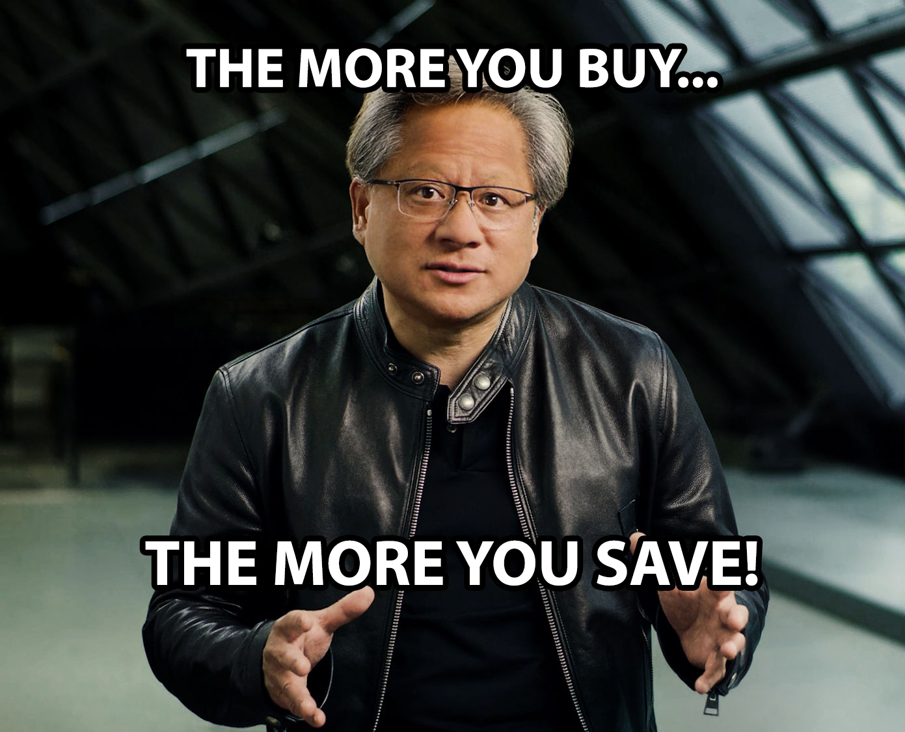

# RAP image test

The tests ask what is in `image.png`, using the read tool. The answer must contain
`THE MORE YOU BUY` and `THE MORE YOU SAVE`, ignoring letter case.
The prompt does not reveal the expected text. Each test also asks for the model
name and warns if it differs from the requested model. Verify routing through
RAP metadata or provider records.

Use an endpoint that supports images. Client settings enable image transmission,
but do not add vision to a text-only model.
